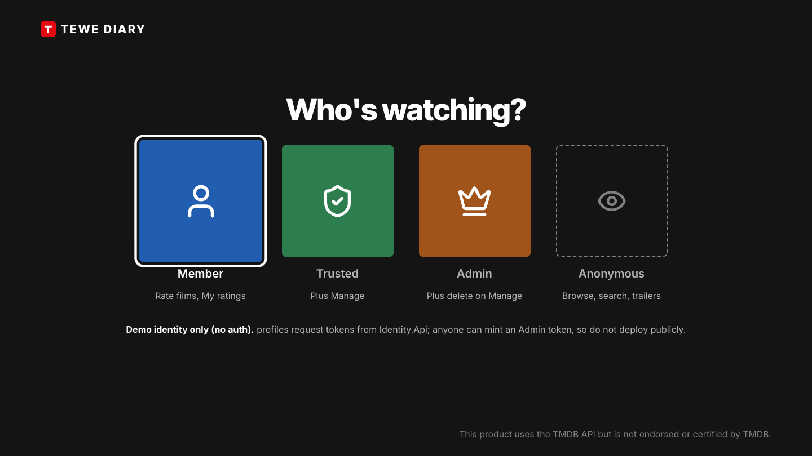
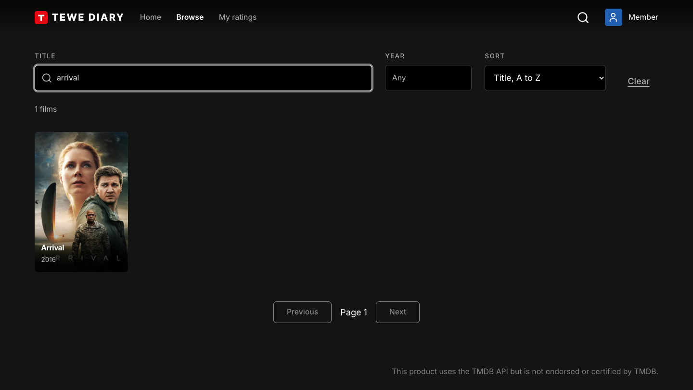
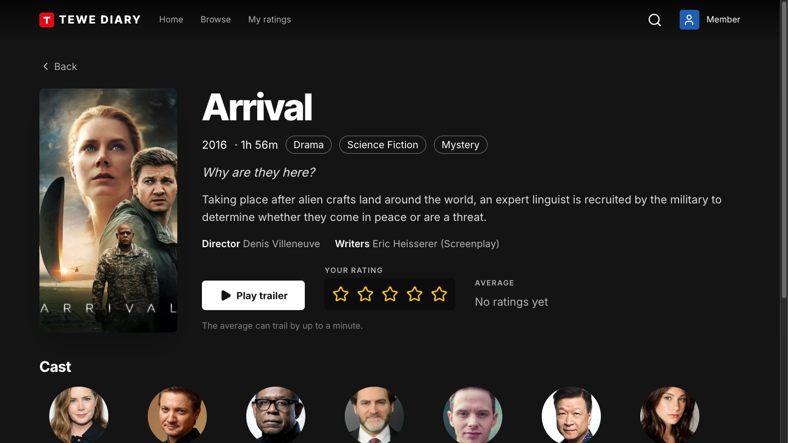
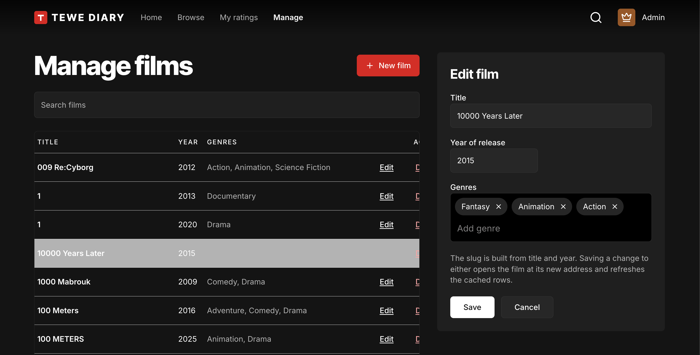

An API repo has a problem: to see it working, you need Postman or curl, a token, and some patience. Most reviewers will give it about thirty seconds.

So I built a frontend. Not because a movie diary needs a pretty face, but because a small React app that exercises the API end to end lets someone see every authorisation tier doing its job without learning a tool first. It signs in, it browses, it rates, and what you can do depends on who you are.

This is Part 12 of **Building Tewe Diary**, after [Part 11](/blogs/building-tewe-diary-part-11-the-dotnet-10-upgrade-run-from-a-prd/). It's about **building a React frontend from a PRD** with a coding agent, and about keeping it small on purpose.

## What the app is for

The PRD states the purpose in one line: a React app that exercises the API end to end, so a reviewer can see it working. That sentence decided a lot. It's a demonstration of the API, not a product, which means every screen has to earn its place by showing something about the backend.

It signs in through the Identity service, keeps the JWT in memory, and shows what each tier unlocks.

## Four tiers, four views

The tiers are the ones from Part 3, made visible.

**Anonymous** gets the poster grid with title and year filters, sorting and paging, and a movie page built from the single GET: overview, tagline, trailer, director, writers and cast.

**Any signed-in user** can rate and un-rate a movie, and sees a My Ratings view.

**Trusted** can create and edit movies, with validation errors shown inline from the API's error contract.

**Admin** can delete movies.

A reviewer can sign in as each, in turn, and watch the same screen offer different things. It's the quickest demonstration I know that authorisation is real and not decorative.

## Choices I made, and wrote down

The PRD lists the stack and the reasoning, and the amendments are in the history. Vite and TypeScript for the build. Tailwind version 4 and shadcn/ui for the interface, because I wanted to practise that combination and because the components are copied into the repo, so there is no hidden dependency. Docker for dev, test and deploy, with nginx serving the build and proxying the API from the same origin, so there is no cross-origin set-up to explain.

The JWT lives in memory, not in local storage. A reload signs you out, which is a nuisance and a deliberate one. Storing tokens where any script on the page can read them is a habit I'd rather not show off.

## A look I borrowed from the big screen

The design is TV-style: profile selection, a hero banner, rows of posters. I made design artboards first as a mock, then built phase one against them. The home hero is configurable through a list of slugs, so I can choose which films it features without a code change.

Small details came from using it. A hero that copes with long titles. A per-profile icon on the profile screen. An "Also from this year" row on the movie page and in the modal, built from the API's existing filter, which was a nice check that the backend gave the frontend what it needed without special help.

## The screens

All of these are from the running stack at 1440 by 810, and the full set is in the repo's frontend screens page.

### Who's watching?

The first screen. Member, Trusted and Admin ask the Identity service for a token with that tier's claims, and Anonymous stays signed out. To be clear about what this is: it's a demo identity, not authentication. Anyone can mint an Admin token, so I never deploy this build publicly.

### Home

A hero with a muted trailer behind the title. Five bars under it switch the featured film by mouse, or by arrow keys and Enter.

Poster rows below the hero. Arrow keys move across cards and rows, and Enter opens a film.

### Browse

With nothing searched, it lists the current year's films, and the count says so.

Title and year filters, sorting and paging. The URL holds the state, so a search can be bookmarked or shared.

### Movie

The movie page, with trailer, cast and a star rating. Opening a card from Home shows the same body in a modal.

Under the cast, a row lists up to five other films from the same year that have a poster. It uses the same year filter as Browse, so it needed no extra API.

### My ratings

The films the signed-in profile has rated. It's empty for a profile that has rated nothing.

### Manage

Create, edit and delete films. The screen is shown only to Trusted and Admin, and the API requires Admin to delete. The API enforces the tiers itself: hiding the screen is convenience, not security.

### The API behind it

The frontend calls the version 2 endpoints, through nginx, so the browser never talks to the API directly. The Swagger page above shows the 2.0 definition, which is the Minimal API surface from Part 10.

## Checking where the trailer message comes from

One detail is worth a mention because it's the sort of thing that's easy to skip. The movie page embeds a trailer, and the embed talks back to the page through a message. The page checks the origin of that message before acting on it, so a message from somewhere else is ignored.

It's a few lines, and it's the kind of security habit that should be in a demo precisely because demos get copied.

## Essential tests only

The PRD says essential tests only, and I stuck to it. The frontend isn't the product, and a heavy test suite for a demonstration shell would be effort in the wrong place. The backend has the thorough tests; the frontend has enough to say the build is sound.

It's also kept out of the code quality tool's coverage figures. Mixing a thin frontend into the backend's coverage would drag a meaningful number down for no reason.

## The agent's part

A coding agent wrote much of this. The PRD, the design artboards and the stack choices were mine. The agent worked from them, and I reviewed, adjusted and corrected, which is the same split as the upgrade in Part 11. The first phase landed as work in progress and was then polished in small commits, which is how this kind of work should look in the history.

## Where it falls over

A frontend that only demonstrates is not tested like one that serves users. There's no accessibility audit, no performance work, and no real handling of a flaky network. If someone used it for real, those gaps would show.

Keeping the token in memory means you sign in again on every reload. For a demo that's honest and slightly annoying.

And a second codebase doubles what a reviewer has to read. A frontend can make the repo look larger than the idea behind it. I've kept it in its own folder so it can be ignored.

## The position

**A small frontend that shows each authorisation tier is the quickest way for a reviewer to see an API working.** Write the PRD, say what the app is for, keep the stack boring, keep the tests essential, and let the screens prove the backend.

If your API repo needs a tool to demonstrate it, ask whether a small app would do it faster. Thirty seconds is all you get.

That's the built part of Building Tewe Diary. Two posts about what I'd add next, messaging and scaling, will follow once there's something to describe. The rest of the series is on [the blog](/blogs/).
